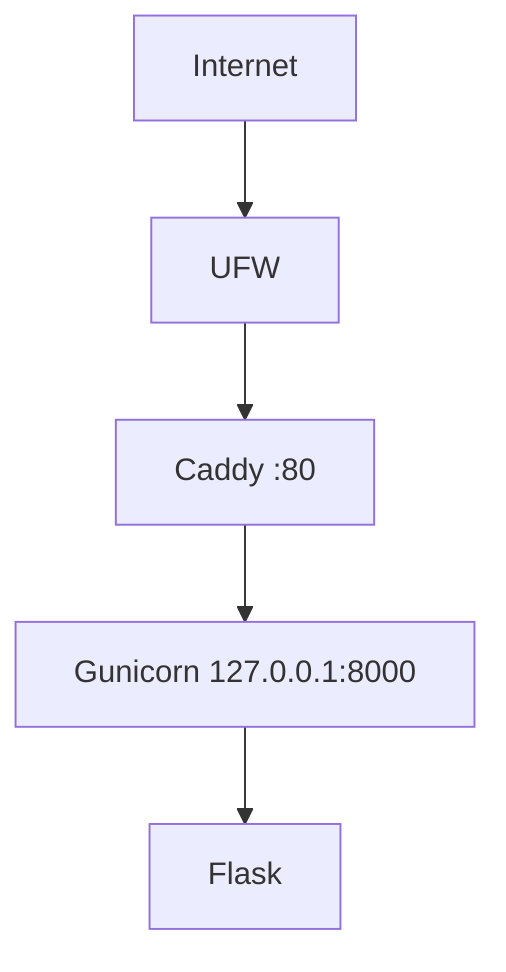

# Architecture v0.1

## Deployment View

## Resource Constraints
- RAM sekitar 1 GB, swap 1 GB
- Gunicorn 1 worker, 2 thread

## Security Decisions
- non-root administration (cloudstudent)
- SSH key authentication
- password SSH disabled
- UFW enabled
- backend loopback-only

## Current Limitations
- HTTP only
- single VPS
- no database
- no container
- no CI/CD

## Planned Evolution
- M04 DNS + HTTPS
- M05 persistent data
- M06 container
- M07 IaC
- M09 CI/CD
